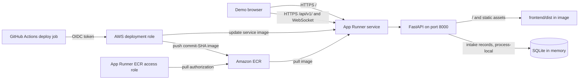

# Implementation Plan: AWS App Runner Deployment

**Branch**: `003-aws-apprunner-deployment` | **Date**: 2026-11-12 | **Spec**: [spec.md](./spec.md)

**Input**: Feature specification at `specs/003-aws-apprunner-deployment/spec.md`

## Summary

Package the existing React/Vite frontend and FastAPI backend in one production
container. Build the browser assets in a Node stage, install the Python backend
and dependencies in a Python stage, and run only FastAPI in the final image.
FastAPI serves the built application and its static assets from the service root
while preserving the existing `/api/v1/` and `/health/live` routes. Use the
existing in-memory SQLite default for the demo, provision ECR and App Runner with
Terraform, and publish commit-addressed images through GitHub Actions using an
OIDC-assumed AWS role. The deployed App Runner service supplies the public HTTPS
URL after provisioning.

## Technical Context

**Language/Version**: Python 3.11; Node.js 20; TypeScript

**Primary Dependencies**: FastAPI, Uvicorn, SQLAlchemy, SQLite, React 19, Vite,
Docker, Terraform, GitHub Actions, Amazon ECR, AWS App Runner

**Storage**: SQLite `sqlite+pysqlite:///:memory:` for the public demo. The
existing SQLAlchemy `StaticPool` shares the in-memory database within one
process; records are lost on process replacement/restart and are not shared
between App Runner instances. No RDS, database VPC connector, or durable-data
claim is part of this design.

**Testing**: Existing pytest backend suite and Vitest frontend suite; production
image build, local container smoke tests, Terraform format/validation, and static
workflow/IAM policy checks.

**Target Platform**: Linux containers on AWS App Runner, container port 8000,
public HTTPS ingress, private ECR image source.

**Project Type**: Existing React frontend plus Python API, deployed as one web
service.

**Performance Goals**: No new latency or throughput SLO is specified. Configure
the initial demo autoscaling maximum to one instance to avoid split in-memory
session state; revisit before any multi-instance or production use.

**Constraints**:
- The runtime image contains both the compiled frontend and the FastAPI app;
  it runs one application process and exposes port 8000.
- `/health/live` is the App Runner health path. It must remain reachable before
  any frontend fallback route.
- `/api/v1/` and WebSocket API routes must be resolved by FastAPI and never by
  the frontend fallback.
- `.copilotignore` and `.dockerignore` independently exclude `.env*` and local
  database files. Secrets are not build args or image layers.
- The origin policy allows exact origins from `APP_ORIGIN` and the comma-separated
  `ALLOWED_ORIGINS`, origins whose parsed hostname is a subdomain of
  `.awsapprunner.com`, and an Origin authority that matches the request Host.
  Missing, malformed, or unrelated origins remain denied.
- GitHub Actions has `id-token: write` only on the deploy job and uses OIDC
  audience and repository/ref-scoped AWS trust. No long-lived AWS credentials.
- AWS-generated service URL is emitted only after the service reaches a
  provisioned state.
- SQLite data is demo-only and disposable. The App Runner service and ECR may
  still incur AWS charges; the zero-cost requirement applies to database/VPC
  dependencies, not all AWS usage.

**Scale/Scope**: One service, one runtime image, one ECR repository, one
App Runner service, and one narrowly scoped CI deployment role. Durable storage,
multi-instance consistency, custom domains, and application identity-provider
integration are outside this deployment feature.

## Constitution Check

| Principle | Deployment impact | Result |
|---|---|---|
| I. Deterministic Safety Gate - NoFacts Pattern | No extraction, persistence, or candidate-validation logic changes. | PASS |
| II. Zero-Disk Ephemeral Ingestion | Container packaging must not alter existing RAM-only upload processing. | PASS; container smoke tests must verify API behavior remains unchanged. |
| III. Canonical Schema and Human-Only Boundaries | The existing schema and write boundaries remain unchanged. | PASS |
| IV. One Clarification Question per Turn | The existing intake graph remains unchanged. | PASS |
| V. Zero-Trust Security and PII Protection | GitHub-to-AWS deployment uses scoped OIDC; no cloud keys are stored. App logs remain PII-free. | PASS |
| VI. CI Golden Evaluation Gate | Existing golden evaluation stays a required CI gate; deployment checks are additive. | PASS |

No constitutional exception is required. For the cohort evaluation live demo,
`AUTH_REQUIRED=false` and the existing default `employee-1` subject are
intentional. This gives cohort participants the shared demo identity; it is not
production authentication or user isolation. The public demo must use only
synthetic, non-sensitive data and must not be presented as a secure production
intake service.

## Architecture



### Container and request routing

1. The Docker build context is the repository root. `.dockerignore` removes
   secrets, local databases, VCS state, caches, and host-generated build output.
   `.copilotignore` separately applies the requested Copilot context boundary.
2. The frontend build stage installs from the checked-in npm lockfile and runs
   the existing production build, yielding `frontend/dist`.
3. A Python 3.11 build stage installs the backend project and its runtime
   dependencies into a virtual environment. The final Python runtime stage copies
   that environment and the frontend build output, runs as a non-root user, and
   does not include Node.js, npm caches, tests, or source-control metadata.
4. The container launches Uvicorn bound to `0.0.0.0:8000`. FastAPI serves `/`,
   built assets, and browser-side navigation fallback. Existing `/api/v1/`,
   WebSocket, and `/health/live` routes are registered before the fallback and
   retain their existing response behavior. Missing API, health, or static asset
   paths return errors rather than `index.html`.
5. Same-origin frontend API URLs remain relative. The existing Vite dev proxy is
   only for local development and is not included in the production request path.
6. The origin guard allows exact normalized origins configured by `APP_ORIGIN`
  or the comma-separated `ALLOWED_ORIGINS`; origins on an
  `*.awsapprunner.com` hostname; and requests whose parsed Origin authority
  exactly matches the request Host. Apply the same decision to HTTP and
  WebSocket handshakes. Reject missing, malformed, `null`, and unrelated origins;
  do not use a broad wildcard for other domains. The App Runner suffix rule
  accepts origins from sibling App Runner services and is an explicit
  cohort-demo-only risk decision, not a production origin policy.

### AWS identity and deployment

- One-time Terraform bootstrap under `deploy/bootstrap/` provisions the ECR
  repository, GitHub OIDC deployment role/trust, App Runner ECR access role, and
  their scoped policies (or references an existing account OIDC provider). Its
  remote state backend is operator-provisioned before bootstrap. The ECR
  repository and deployment role must exist before the first workflow run.
- Terraform under `deploy/apprunner/` defines the App Runner service from a
  supplied ECR image tag. It configures port `8000`, `/health/live`, public
  ingress, runtime demo settings, and autoscaling with a single maximum
  instance. This service stack is applied only after CI has pushed the image.
- The App Runner ECR access role is distinct from the GitHub Actions deployment
  role. The runtime instance role is omitted unless the application later needs
  AWS APIs. The ECR access role grants image-pull permissions only.
- `.github/workflows/cd.yml` runs for the deployment branch and manual dispatch.
  Its deployment job declares only the required content-read and OIDC token
  permissions and configures AWS credentials through OIDC. **Phase A** builds
  and pushes the unified image to the pre-provisioned ECR repository under the
  immutable commit SHA. **Phase B** supplies that exact tag to Terraform to
  create the App Runner service on first deployment or update it thereafter,
  waits for health, and reports the AWS-assigned service URL. The workflow never
  attempts a service update before Phase A succeeds.
- The IAM trust policy restricts `aud` to AWS STS and `sub` to the intended
  repository and deployment ref/environment. The role can push only to the
  target ECR repository, operate on only the configured App Runner service, and
  access only the configured Terraform state backend. `iam:PassRole`, when
  required, is limited to the App Runner ECR access role. Separate and review
  create-time permissions (before a service ARN exists) and update-time
  permissions. Scope service creation to the configured service name/resource
  pattern where AWS supports it; if a create action requires `Resource: "*"`,
  isolate that action to the dedicated deployment role, exact repository/ref
  trust, configured region/account, and service-name conditions where supported,
  and document the limitation. Grant only the provider-required App Runner
  create/describe/update/deploy/tag actions and the minimum Terraform state
  backend actions.
- Initial OIDC role/repository bootstrap, Terraform state storage, and GitHub
  variables (region, role ARN, ECR repository, Terraform backend, and service
  configuration) are operator-provisioned prerequisites. None are AWS
  access-key secrets. The App Runner service itself is created in Phase B after
  the initial image push.

### Data and operational behavior

- Omit `DATABASE_URL` in the demo service so the existing application default
  selects in-memory SQLite. Do not mount a volume or configure RDS/VPC access.
- App Runner instance replacement resets all demo sessions and records. A single
  maximum instance avoids per-instance database divergence but does not make the
  database durable. The UI/demo documentation must not imply persistence.
- Health is a liveness check only. It must not depend on frontend route fallback
  or external AWS/database resources.
- The public HTTPS URL is taken from the App Runner service details after
  provisioning. No placeholder or hard-coded service URL is treated as live.

## Project Structure

### Documentation (this feature)

```text
specs/003-aws-apprunner-deployment/
├── spec.md
└── plan.md
```

### Source Code (repository root)

```text
Dockerfile                         # Multi-stage frontend/backend image
.dockerignore                      # Docker build-context exclusions
.copilotignore                     # Copilot context exclusions
.github/workflows/
└── cd.yml                          # OIDC ECR publish and App Runner rollout
backend/src/aimplify_intake/api/
└── app.py                          # Static frontend and SPA route handling
deploy/apprunner/
├── main.tf                         # App Runner service and scaling
├── variables.tf                    # Region/image/service configuration
└── outputs.tf                      # Service ARN and generated HTTPS URL
deploy/bootstrap/
├── main.tf                         # ECR, OIDC and App Runner access roles
└── variables.tf                    # Repository and GitHub identity inputs
frontend/
└── dist/                           # Generated in image build; not committed
```

**Structure Decision**: Keep the application in the existing backend and
frontend projects. Add a root Dockerfile for the unified build, separate
one-time bootstrap and service Terraform roots, and one GitHub Actions
deployment workflow. Static serving belongs in the FastAPI app because it owns
both the health/API routes and the container process.

## Implementation Sequence

1. **Build-context boundary**: Add `.copilotignore` patterns for `.env*` and
   local database files; align `.dockerignore` with those patterns and add
   automated assertions that no matching file enters the image context/image.
2. **Origin and identity policy**: Implement and test exact configured origin
  matching, App Runner hostname matching, and Origin-to-Host matching for both
  HTTP and WebSocket requests. Explicitly configure `AUTH_REQUIRED=false` for
  the cohort demo and document the shared `employee-1` identity and data limits.
3. **FastAPI static hosting**: Add configurable static directory resolution,
   serve the built root/assets, and add an SPA fallback that cannot shadow
   `/api/v1/`, WebSockets, or health endpoints. Keep app creation usable in tests
   where the production frontend build is absent.
4. **Unified image**: Add the root multi-stage Dockerfile, non-root runtime user,
   port 8000 entrypoint, and build-time failure if the required frontend output
   or backend package is missing. Build from the repository root.
5. **AWS bootstrap**: Add one-time Terraform resources for ECR, GitHub OIDC
  trust/deployment role, and the App Runner ECR access role. Document the
  operator-provisioned remote state backend and bootstrap ordering.
6. **App Runner service**: Add service Terraform that accepts the image tag,
  configures public ingress, `/health/live`, port 8000, one-instance demo
  scaling, SQLite defaults, and outputs the assigned service URL.
7. **Two-phase OIDC deployment workflow**: Add least-privilege GitHub Actions
  permissions, Phase A SHA-tagged image build/push, then Phase B Terraform
  create/update from that image tag, health wait, and URL reporting. Do not add
  AWS access-key secrets.
8. **Operator runbook and CI gates**: Document one-time AWS bootstrap,
   Terraform state prerequisites, first deployment, URL retrieval, local SQLite
  limitations, intentional shared demo identity, and teardown. Add container,
  origin-policy, Terraform, and workflow policy checks without weakening
  existing backend, frontend, or golden gates.

## Validation Plan

- **Backend routing**: Test `/`, a built asset, a client-side route, unknown
  `/api/v1/`, `/health/live`, and a WebSocket route. Verify API/health errors are
  never rewritten to frontend HTML.
- **Origin policy**: Verify exact `APP_ORIGIN` and `ALLOWED_ORIGINS` matches,
  `*.awsapprunner.com` hostnames, and matching Origin/Host are accepted for
  HTTP and WebSocket requests. Verify malformed, missing, unrelated, deceptive
  suffix, and disallowed origins are denied.
- **SQLite demo**: Start the app without `DATABASE_URL`; create and read a
  session in-process. Document that restart and scale-out persistence are not
  tested or guaranteed.
- **Image build**: Build the root Dockerfile in CI. Inspect image contents for
  frontend assets, installed backend, non-root runtime, port 8000, and absence
  of `.env*`, `*.db`, `*.sqlite*`, build caches, and credentials.
- **Container smoke test**: Run the image without AWS credentials or a network
  database; poll `/health/live`, fetch `/`, and verify API routing on port 8000.
- **Application regressions**: Run the existing backend pytest suite, frontend
  Vitest suite, frontend typecheck/build, and golden evaluation unchanged.
- **Terraform**: Run `terraform fmt -check` and `terraform validate`; inspect the
  plan for public App Runner ingress, private ECR image source, correct health
  path, one-instance demo scaling, restricted trust, and least-privilege roles.
- **Workflow/security**: Validate workflow YAML and assert the deploy job has
  OIDC token permission, no static cloud credential references, commit-SHA image
  tags, repository/ref-scoped trust, resource-scoped IAM policies, and strict
  Phase A-before-Phase B ordering. Verify failed image pushes prevent service
  creation/update. No AWS deployment is required for ordinary pull-request
  validation.
- **Live deployment gate**: After a maintainer provisions AWS prerequisites,
  deploy and verify the service reports `RUNNING`, health checks pass, and the
  generated HTTPS URL serves the frontend and API. This gate requires an AWS
  account and is not replaceable by local container tests.

## Complexity Tracking

No constitution violations are proposed. Terraform is selected because the
service consumes an ECR image; `apprunner.yaml` is not used as an image-source
deployment manifest. A persistent Terraform state backend is an infrastructure
prerequisite, not a second application database.